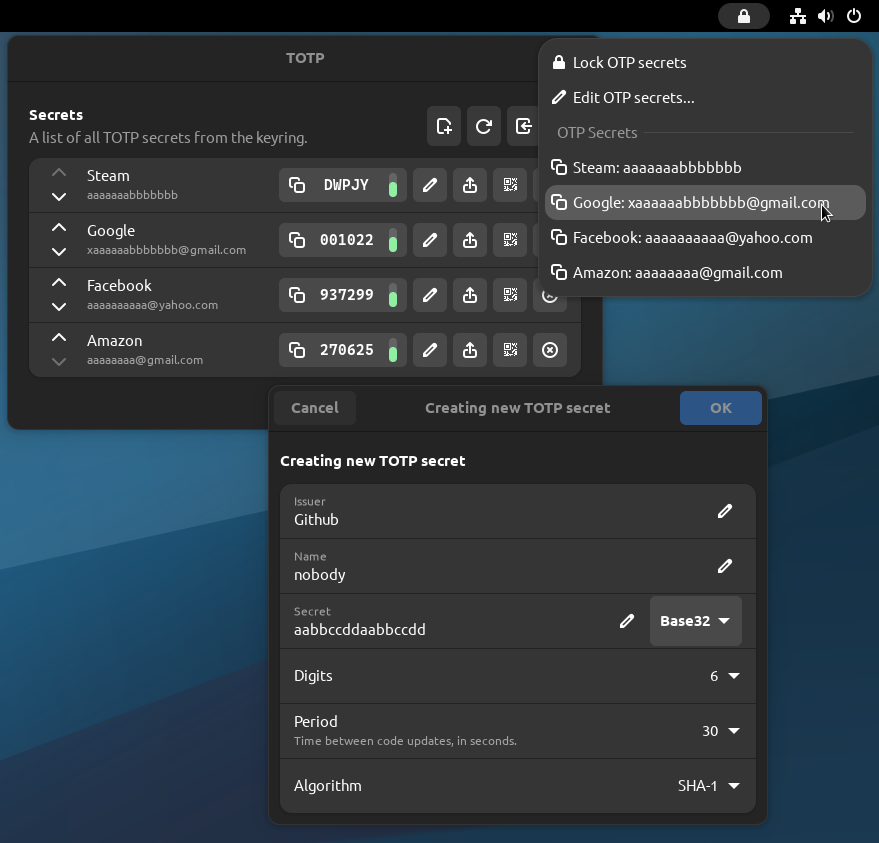

# TOTP

This is a GNOME Shell extension to generate TOTP (Time-based OTP) and HOTP (counter-based
OTP) authentication codes (such as the ones used by Google, Facebook, Github, Steam, etc).

## Security

The OTP secret is stored in the [GNOME
Keyring](https://wiki.gnome.org/Projects/GnomeKeyring), in a separate collection called
"OTP". For improved security, users can lock this collection with its own password.

During normal usage, the extension will load the specific OTP secret (unlocking the
Keyring if necessary), copy the authentication code to the clipboard, and immediately wipe
the OTP secret from memory.

In the preferences window, sensitive data (the `otpauth://` URIs) are automatically
erased from the clipboard after a few seconds (30 by default).

## Installing from GNOME Shell Extensions website

The extension can be obtained from the [GNOME Shell Extensions
website](https://extensions.gnome.org/extension/6793/totp/).

## Installing from sources

Prerequisites:

  - [make](https://www.gnu.org/software/make/)

  - [jq](https://stedolan.github.io/jq/)

  - glib2-devel (Fedora) or glib2.0-common (Mageia) or libgio-2.0-dev-bin (Ubuntu):
    whatever is the package that provides the `glib-compile-resources` tool.

Run:

    make install

## Importing and exporting URIs

It's possible to import and export OTP secrets that conform to [Google's Key URI
Format](https://github.com/google/google-authenticator/wiki/Key-Uri-Format). This format
is compatible with applications like Google Authenticator, FreeOTP, Authy, etc.

## Scanning QR codes

It's possible to scan QR codes from a camera and from the clipboard, if you have the
[ZBar](https://zbar.sourceforge.net/) package installed. In some distros (like Debian and
Ubuntu) the package is named `zbar-tools`.

## Exporting QR code

It's possible to export the OTP secret as a QR code to be scanned into other devices, if
you have the [qrencode](https://fukuchi.org/works/qrencode/) package installed.

## Importing Steam Guard secret

You can generate Steam Guard Mobile Authenticator codes, by importing the "shared secret"
from your Android phone.

See the [Steam Guard](steam.md) document for more details.

## Yandex OTP (YAOTP)

This fork also supports the `otpauth://yaotp/...` entries that [Yandex
ID](https://id.yandex.ru) (formerly Yandex.Key) exports, in both of its flavours:

  - **new (digits)** — plain RFC 6238 over the whole exported secret: SHA-1, 6-digit
    code, 30 s period, no PIN. This is what the Yandex ID app shows for the account
    itself.
  - **old (letters)** — Yandex's proprietary scheme: the key is `SHA-256(pin || secret)`,
    the HMAC-SHA-256 output is truncated to 64 bits, and the code consists of 8 lowercase
    letters. A PIN is mandatory and Yandex never exports it, so it must be typed into the
    entry; it is kept as an additional keyring attribute.

The export's own parameters are not reliable (`chars=alpha` was seen on an entry that
shows digits), so the scheme is a setting: *Yandex scheme* → `Auto`, `Letters (old, with
PIN)` or `Digits (new)`. `Auto` guesses from the shape of the secret — the 18-byte form
whose checksum does not verify, which is what the file export produces, is treated as
digits; 16-byte QR secrets and 26-byte secrets with a valid checksum as letters.

Secret lengths accepted: 16 bytes (QR, letters scheme), 18 bytes (file export) and 26
bytes and longer (key + user id + PIN length + a 13-bit checksum, which is verified).

The letters scheme follows the reference implementations in
[KeeYaOtp](https://github.com/norblik/KeeYaOtp),
[libcotp](https://github.com/paolostivanin/libcotp) and
[Aegis](https://github.com/beemdevelopment/Aegis), and is checked against the published
Aegis test vectors. Tests live in `tests/` and run with, for example,
`gjs -m tests/yaotp_test.js`.

## Related extensions

When using this extension on a laptop, it's a good idea to also install [Keyring
Autolock](https://extensions.gnome.org/extension/6846/keyring-autolock/). It will ensure
your Keyring gets locked after a period of time, so you never forget to keep your OTP
secrets protected.
